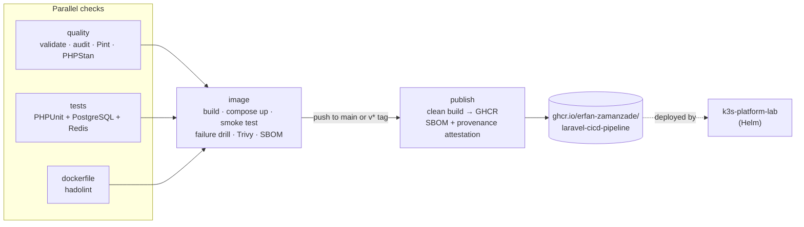
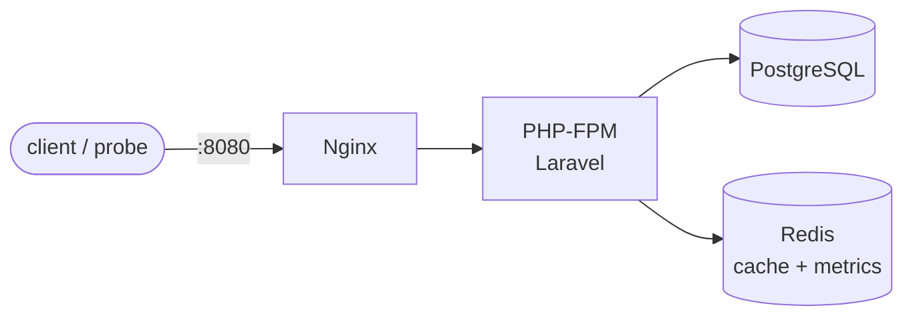

# laravel-cicd-pipeline

[](https://github.com/erfan-zamanzade/laravel-cicd-pipeline/actions/workflows/ci.yml)

A production-style CI/CD pipeline for a containerised PHP service, built with GitHub Actions and mirrored in GitLab CI.

The application is intentionally tiny: a Laravel service that exposes health, readiness, build info and Prometheus metrics. **The pipeline and the operational behaviour are the point of this repository**, not the business logic. The same image is the deployment target of the upcoming k3s platform lab (in progress).

## What it demonstrates

| Area | How |
|------|-----|
| Pull-request validation | Every PR runs lint, static analysis, tests, image build, smoke test and vulnerability scan |
| Code quality | Pint (style), PHPStan level 8 with Larastan, `composer validate --strict` |
| Tests against real services | PHPUnit against PostgreSQL 17 and Redis 7 service containers, coverage report as artifact |
| Container build | Multi-stage Dockerfile, no Composer or dev dependencies in the runtime image, runs as non-root `www-data` |
| Container validation | `docker compose` stack + smoke test, including a database failure drill |
| Supply-chain security | `composer audit`, Trivy image scan (gate + SARIF to code scanning), SPDX SBOM, build provenance attestation, actions pinned to commit SHAs, Dependabot with a 7-day cooldown, workflow audited with zizmor |
| Least privilege | Workflow defaults to `contents: read`; only the publish job can write packages |
| Reproducible tagging | Images tagged `sha-<commit>` (immutable), branch, and SemVer from `v*.*.*` tags; version and commit baked into the image and reported at `/` |
| Secrets | None required: the registry login uses the short-lived `GITHUB_TOKEN`; no credentials are stored in the repo |

## Architecture



Runtime layout of the image:



### Endpoints

| Path | Purpose | Depends on |
|------|---------|------------|
| `/` | Name, version, commit, PHP and Laravel versions | — |
| `/health` | Liveness: the process serves PHP | nothing (so a database outage never restarts the container) |
| `/ready` | Readiness: database and cache reachable, with per-check latency; `503` otherwise | PostgreSQL, Redis |
| `/metrics` | Prometheus text format: `app_info`, `http_requests_total`, `http_request_duration_seconds_sum` by method, route pattern and status | Redis |

Request counters live in Redis so they are shared across PHP-FPM workers and replicas. A failing metrics backend is logged but never fails the request being measured.

## Technology choices

- **GitHub Actions** as the primary CI: free for public repositories, native GHCR and attestation support. **GitLab CI** equivalent in [`.gitlab-ci.yml`](.gitlab-ci.yml) because many teams (including my previous ones) run GitLab with self-managed runners.
- **[serversideup/php](https://serversideup.net/open-source/docker-php/)** base image: maintained Nginx + PHP-FPM image that runs unprivileged on port 8080 and ships a working healthcheck. Pinned to an exact version.
- **Trivy** for image scanning and **Syft** (via `anchore/sbom-action`) for the SBOM: both open source, no account needed.
- **Migrations as a one-off step** (`migrate` service in Compose), not on container start, so several replicas never race on the schema.

## Run it locally

Prerequisites: Docker with Compose v2. Nothing else; PHP and Composer run in containers.

```bash
make install          # composer install (in a container)
make up               # app + PostgreSQL + Redis on http://127.0.0.1:8080
curl -s localhost:8080/ready
make down
```

Use `APP_PORT=18080 make up` if port 8080 is taken.

## Run the tests

```bash
make check            # Pint, PHPStan, PHPUnit (SQLite + in-memory stores)
make ci               # the whole pipeline: checks, hadolint, build, compose up, smoke test, Trivy, compose down
```

In CI the same test suite runs against real PostgreSQL and Redis (see the `tests` job).

## CI/CD workflow

[`.github/workflows/ci.yml`](.github/workflows/ci.yml)

| Trigger | Jobs |
|---------|------|
| Pull request | quality, tests, dockerfile → image |
| Push to `main` | as above → publish `sha-<commit>` and `main` |
| Tag `vX.Y.Z` | as above → publish `X.Y.Z`, `X.Y` and `sha-<commit>` |

The `image` job fails the pipeline if the smoke test fails, or if Trivy finds a HIGH or CRITICAL vulnerability that already has a fix. That gate caught a real issue while building this project: the base image shipped a `curl` with CVE-2026-92392; the Dockerfile now applies OS security updates on build.

## Deployment

The pipeline's deliverable is a scanned, attested image in GHCR. Deployments should reference the immutable `sha-<commit>` tag or the digest, never `main`.

Deployment itself is the job of the upcoming k3s platform lab (Helm chart with readiness/liveness probes wired to `/ready` and `/health`, rolling updates and rollback). Until that repository is published, the image can be run anywhere Docker runs:

```bash
docker compose up --detach --wait   # uses APP_IMAGE if set, e.g. ghcr.io/erfan-zamanzade/laravel-cicd-pipeline:sha-<commit>
```

Verify a published image's provenance:

```bash
gh attestation verify oci://ghcr.io/erfan-zamanzade/laravel-cicd-pipeline:main --owner erfan-zamanzade
```

## Security considerations

- Runtime container runs as `www-data` (uid 82); Compose drops all Linux capabilities and sets `no-new-privileges`.
- `APP_DEBUG=false` in the image; readiness errors are reduced to `unavailable` unless debug is on.
- The service is stateless: no sessions, cookies or CSRF tokens, so no `APP_KEY` is needed.
- The database password in `docker-compose.yml` / `.env.example` only protects a local throwaway container. Real deployments inject it as a secret.
- The publish job never restores a cache, so the released image is always a clean build.

## Cost and resources

$0. Public repository, GitHub Actions minutes for public repos, GHCR for public images. A full pipeline run takes a few minutes on a standard GitHub-hosted runner. Locally the stack needs roughly 300 MB of RAM; the image is about 240 MB.

## Troubleshooting

| Symptom | Check |
|---------|-------|
| `/ready` returns 503 | Response body names the failing check; `docker compose logs postgres redis` |
| App container stays `starting` | `docker compose logs app`; the healthcheck calls `/health` on port 8080 |
| Port 8080 already in use | `APP_PORT=18080 make up` |
| Redis exits with `setresuid failed` | Compose must start Redis as `user: redis` because capabilities are dropped |
| Trivy job fails | A fixed HIGH/CRITICAL CVE exists: rebuild (the Dockerfile pulls OS updates) or bump the base image |

## Known limitations

- The application is a demo vehicle; it has no business logic, authentication or rate limiting.
- `.gitlab-ci.yml` is validated and partially executed locally with [gitlab-ci-local](https://github.com/firecow/gitlab-ci-local); the `build`, `scan` and `publish` jobs need a GitLab registry and have not been run on gitlab.com.
- `http_request_duration_seconds_sum` gives average latency, not percentiles; histograms come with the monitoring work in the platform lab.
- GHCR packages may start private; the owner sets visibility to public once in the package settings.

## Verification evidence

| Check | Where | Result |
|-------|-------|--------|
| Full local pipeline (`make ci`) | Ubuntu server, Docker 29.3 | Passed on 2026-10-29 |
| GitLab jobs `quality`, `dockerfile`, `tests` | gitlab-ci-local 4.77.0, PostgreSQL + Redis services | Passed on 2026-10-29 |
| GitHub Actions | [Actions tab](https://github.com/erfan-zamanzade/laravel-cicd-pipeline/actions/workflows/ci.yml) | See latest run |
| Workflow lint | actionlint 1.7.7, zizmor | No findings |

## Future improvements

- Deploy job to the k3s lab cluster with environment protection rules.
- Signed images with cosign keyless signing in addition to the provenance attestation.
- Latency histograms and an SLO-based alert in the monitoring stack.
